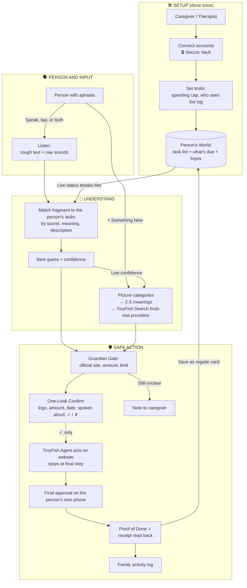

<div align="center">

#  SETU

### *Say it broken. We'll finish it.*

**An assistant that reads the web, understands broken speech, and completes everyday online tasks for people with aphasia, with the person always in control.**

`Hackathon Project` · `Accessibility` · `Healthcare` · `Powered by TinyFish`

</div>

---

## 📖 Table of Contents

1. [The Problem](#-the-problem)
2. [Our Solution](#-our-solution)
3. [See It in Action](#-see-it-in-action)
4. [Features](#-features)
5. [What Makes SETU Different (USP)](#-what-makes-setu-different-usp)
6. [How It Works](#-how-it-works)
7. [How We Use TinyFish](#-how-we-use-tinyfish)
8. [Safety, Privacy and Trust](#-safety-privacy-and-trust)
9. [Tech Stack](#-tech-stack)
10. [Getting Started](#-getting-started)
11. [Project Structure](#-project-structure)
12. [Use Cases, Feasibility and Scalability](#-use-cases-feasibility-and-scalability)
13. [Honest Limitations](#-honest-limitations)
14. [Team, License and Acknowledgements](#-team-license-and-acknowledgements)

---

## 💔 The Problem

After a stroke, about **1 in 3 survivors develops aphasia**, a condition that damages the ability to find words, speak, read, and write.

> **Aphasia is a loss of language, not a loss of intelligence.**

Meet **Ramesh, 62**. He knows his electricity bill is due on Friday. He knows his doctor's visit needs rebooking. But:

- He **cannot read** the website properly
- He **cannot find the word** or type the name of the company
- He **cannot explain himself** clearly on a phone call

So he waits for his daughter to visit on Sunday.

**The gap nobody fills:** existing aphasia apps (called AAC apps) help a person *say something* to someone standing in front of them. That is valuable, but those apps **don't get anything done** on the internet.

> **The problem is not expression. It is execution.**
> The web assumes everyone can read and type. After a stroke, many people can't.

---

## 💡 Our Solution

**SETU** (Sanskrit/Hindi for *"bridge"*) is a bridge between a person with aphasia and the websites they depend on.

It does three simple things:

| Step | What SETU does | In plain words |
|---|---|---|
| 👁️ **Reads** | Logs into the person's online accounts and shows what matters today as big picture cards | "Here is what needs your attention." |
| 🧠 **Understands** | Combines the broken words the person managed to say with what is actually happening in their life | "You said *bill... pay...* and only the electricity bill is due, so that's the one." |
| 🤝 **Does** | Completes the task on the real website after the person approves on a simple picture screen | "Done. Here is your receipt." |

### The core idea

> **A broken sentence carries very little information. The person's life carries the rest.**

A daughter does this naturally. When her father says *"the... money... the light"*, she knows what is due and replies, *"The electricity bill?"*

SETU does the same thing, automatically.

---

## 🎬 See It in Action

**Scenario:** Ramesh says *"bill... the... pay... the one"*.

```
1. Today Board already shows:   ⚡ Electricity  ₹1,840  Due Friday
2. Ramesh's words alone:        3 bills could match (electricity, water, phone)
3. SETU checks live accounts:   only electricity is overdue
4. Confirm card appears:        logo + amount + date, read aloud, one big ✓
5. Ramesh taps ✓
6. Agent fills the payment form and stops at the final step
7. Ramesh approves on his own phone (UPI / bank PIN)
8. Receipt is read back:        "Done ✓"  and the family log is updated
```

**The key moment:** play the *same voice recording* again after the electricity bill is paid and the water bill becomes overdue. SETU now picks **water**.

> *The voice didn't change. The world did. That is why SETU needs the live web.*

---

## ✨ Features

| Feature | What it does | Why it matters |
|---|---|---|
| 🛠️ **Gentle Setup** | A caregiver or therapist connects accounts once. The person approves what's linked and can revoke access anytime. | Consent first. No surprises. |
| 📋 **Today Board** | Big picture cards showing what needs attention now, e.g. "⚡ Electricity ₹1,840, due Friday". Tapping a card is already a complete request. | The person doesn't have to remember. SETU is the memory, the person is the decision-maker. |
| 🎙️ **Any-Way Input** | Speak, tap a picture, or do both. Half-words and wrong words are accepted. | No perfect sentence required. |
| 🔎 **Fragment Decoder** | Matches broken speech to the person's tasks by **sound** ("tefelone" → telephone), **meaning** (says "knife", means "fork"), and **descriptions** ("the white heart one"). | Built around how aphasic speech actually breaks. |
| 🌍 **Live Life Map** | Reads real accounts to know what is due, available, or upcoming right now. | The same words give the *right* answer today. |
| ➕ **Something New** | A separate lane for unusual requests. Uses picture categories and real web search to narrow things down. | People's lives aren't limited to a fixed list. |
| 👁️ **One-Look Confirm** | Logo, amount, date, spoken aloud, one huge ✓ or ✗. No reading needed. | Recognising a picture is much easier than finding a word. |
| 🛡️ **Guardian Gate** | Verifies the official website, checks the amount matches, enforces spending limits, and requires final approval on the person's own phone. | A probabilistic system must never spend money alone. |
| ✅ **Proof of Done** | Reads the receipt, shows "Done ✓", and logs it for the family. | The person and family can see the task actually completed. |

### How "Something New" works

What if the request is something SETU has never seen? It does **not** guess.

1. **Narrow down with pictures.** A grid appears: Bills, Health, Home, Shopping, People, Other. One tap shrinks the problem.
2. **Interpret within that category.** A language model proposes 2-3 possible meanings from the fragments (*"gas... the... man... come"* → "Book a gas cylinder delivery?").
3. **Check against the real web.** TinyFish Search finds real providers and their official sites, so options are real services with logos.
4. **Confirm with pictures.** The person taps the right card, or says no and SETU narrows again.
5. **Act carefully.** Preview first. Anything involving money needs approval.
6. **Learn.** After success: "Save this to your list?" It becomes a regular card.

If SETU still can't tell, it sends the caregiver a short note instead of guessing.

---

## 🏆 What Makes SETU Different (USP)

| | AAC / aphasia apps | Voice assistants | Autopay | **SETU** |
|---|---|---|---|---|
| Works with broken speech | Partly | ❌ | n/a | ✅ |
| Reads the web for the user | ❌ | ❌ | ❌ | ✅ |
| Completes tasks | ❌ | Limited | Fixed bills only | ✅ |
| Handles changing or new tasks | ❌ | Limited | ❌ | ✅ |
| User stays in control | ✅ | Varies | ❌ | ✅ |

**In short:**

1. **Execution, not expression.** Others give a voice. SETU gets the task done.
2. **Reads the web for you.** Solves the *reading* barrier, not only the speaking one.
3. **Understands through their real life.** Same words, different answer when their bills or appointments change.
4. **The person is always in charge.** Their words beat our guess, and they approve every payment.
5. **Built for aphasic speech.** Handles wrong sounds, wrong-but-related words, and "the thing you use for..." descriptions.
6. **Scam shield.** Checks it's the official website before logging in. Older and aphasic users are prime phishing targets.
7. **Measured by what matters.** We track *how few words and fragments a person needs to finish a task*, not just model accuracy.

> **Why not just use UPI autopay?** Autopay works for fixed recurring bills. It can't handle variable bills, rebooking appointments, checking a status, or interpreting a message from a provider. SETU is built for exactly those.

---

## ⚙️ How It Works



### The four layers in simple terms

1. **Listen.** Speech becomes rough text *and* raw sounds. We keep the sounds as clues instead of "correcting" the speech, because a mispronunciation like "tefelone" is a hint, not noise.
2. **Understand.** Sounds and meaning are matched against the person's own small list of tasks (about 20-40). Then live account status re-ranks the guesses.
3. **Guardian Gate.** Confident → show a confirm card. Unsure → show 2-3 picture choices. Anything involving money → always needs approval.
4. **Act.** A TinyFish browser agent does the task on the website and returns proof.

### The golden rule

> **What the person says always overrides what SETU guesses.** The live account data only helps break ties. It never overrules the person.

---

## 🐟 How We Use TinyFish

[TinyFish](https://www.tinyfish.ai) gives AI a way to **use the web like a human would**: search, open pages, log in, click, and fill forms. For SETU, it is the **eyes and hands** on the internet.

**Why TinyFish is essential (not decoration):** the information SETU needs (what's due, what's overdue, what's available) sits behind logins and is controlled by the website, not by us. It **cannot be computed locally**. Take TinyFish away and SETU has no idea what's due, so "bill... pay" stays a guess between three bills.

| Stage | What TinyFish does | Without TinyFish |
|---|---|---|
| 👁️ **Read** | Agent logs into the person's portals and reads bills, due dates, and appointments. This feeds the Live Life Map. | SETU can't tell which bill matters. |
| 🌐 **Ground** | Search finds real, official websites for "Something New" requests. | Options would be guessed, not real. |
| 🔐 **Verify** | Confirms the official domain before login. | No scam protection. |
| 🖱️ **Act** | Fills the form and stops at the final step. | The person is stuck again. |
| 🧾 **Prove** | Reads the receipt and returns the amount and reference. | We'd be acting blind, with no proof. |
| 🚀 **Setup** | Reads the account once to draft the person's task list. | Task list would be hand-typed and wouldn't scale. |

**Other TinyFish benefits we use:**

- **Plain-language instructions** instead of hardcoded page selectors, so one instruction can work across *different* websites. We demonstrate this with two mock portals that have completely different layouts.
- **Secure credential handling** so passwords are kept in a vault and are not placed in the AI's prompt.
- **Live agent trace** shown on screen during the demo so judges and users can see exactly what the agent is doing.

> **Proof in the demo:** same voice recording, but after the website's data changes, SETU gives a different, correct answer.

---

## 🛡️ Safety, Privacy and Trust

Letting software act on someone's accounts is serious. SETU is designed so the agent is **never the final authority** on money.

| Risk | Our safeguard |
|---|---|
| Pays the wrong bill | Confirm card shows biller, amount, and due date. The person must tap ✓. |
| Pays the wrong amount | Amount on the payment page is compared with the amount read earlier. Mismatch → stop. |
| Pays a scam site | Domain is checked against a saved list before login. |
| Pays twice | Bill status is checked before and after. One payment per bill. |
| Spending runs away | Caregiver-set per-payment and monthly caps. Above the cap → caregiver approval. |
| Agent holds PINs | It doesn't. Final authorization happens on the **person's own phone** (UPI / bank PIN). |
| Silent failure | Receipt is read back and logged. |
| Privacy | Consent-first setup, read-only access where possible, only needed accounts, revocable anytime, full activity log. |

SETU is designed around the principles of India's **Digital Personal Data Protection (DPDP) Act, 2023** (consent, minimal data, purpose limitation). This is a design intent, not a compliance claim. A legal review would be required before any real deployment.

**Important:** these safeguards reduce risk, they don't eliminate it. That's why the person stays in the loop for every payment.

---

## 🧰 Tech Stack

> Everything below is free or open source, **except TinyFish** (free tier / hackathon credits).

| Layer | Tool |
|---|---|
| Speech to rough text | [Whisper](https://github.com/openai/whisper) |
| Speech to raw sounds (phonemes) | wav2vec2 phoneme model (Hugging Face) |
| Word to sounds | `g2p_en` |
| Sound similarity | [PanPhon](https://github.com/dmort27/panphon) (articulatory features) |
| Meaning similarity | `all-MiniLM-L6-v2` (sentence-transformers) |
| Backend | Python, FastAPI, WebSocket, SQLite |
| Frontend | React, Web Audio API, large-button UI |
| Text to speech | Browser `speechSynthesis` |
| Pictograms | [ARASAAC](https://arasaac.org) (non-commercial license; fine for a hackathon) |
| Demo portals | Two mock websites with different layouts |
| Web layer | **TinyFish** (Search, Fetch, Agent, Vault/Profiles) |

**Hardware:** no GPU needed. The matching engine is lightweight and runs on a normal laptop CPU.

**No model training.** SETU uses pretrained models plus a small personal task list.

---

## 🚀 Getting Started

> ⚠️ Replace the placeholders below with your actual repo details and verify commands against your codebase.

### Prerequisites

- Python 3.10+
- Node.js 18+
- `espeak-ng` (needed by the phoneme model)
- A TinyFish API key ([get one here](https://www.tinyfish.ai))

### 1. Clone the repo

```bash
git clone https://github.com/<your-username>/setu.git
cd setu
```

### 2. Backend setup

```bash
cd backend
python -m venv venv
source venv/bin/activate        # Windows: venv\Scripts\activate
pip install -r requirements.txt
```

### 3. Add your keys

Create a `.env` file inside `backend/`:

```env
TINYFISH_API_KEY=your_key_here
MOCK=0          # set to 1 to replay recorded agent runs offline
```

### 4. Run the mock portals

```bash
cd mock_portals
python app.py
```

### 5. Run the backend

```bash
cd backend
uvicorn main:app --reload
```

### 6. Run the frontend

```bash
cd frontend
npm install
npm run dev
```

Open the URL shown in the terminal (usually `http://localhost:5173`).

### Demo mode (no internet or API needed)

Set `MOCK=1` in `.env`. Every agent call is recorded and can be replayed offline, which keeps the demo reliable and saves API cost.

---

## 📁 Project Structure

> Adjust to match your actual folders.

```
setu/
├── backend/
│   ├── listen/          # audio → rough text + phonemes
│   ├── decoder/         # sound, meaning, description matching + live prior
│   ├── gate/            # Guardian Gate: confidence + safety checks
│   ├── tinyfish/        # TinyFish wrappers: read, ground, verify, act, prove
│   ├── world/           # Person's World: task list + live status
│   └── main.py
├── frontend/            # Today Board, Confirm card, Something New
├── mock_portals/        # Two sandbox portals with different layouts
├── eval/                # Test fragments + ablation scripts
├── docs/                # Slides, diagrams
└── README.md
```

---

## 🌍 Use Cases, Feasibility and Scalability

### Use cases

- Fill a form
- Research or confirm something
- Rebook a doctor's appointment *(same engine, different task)*
- Check a claim or pension status
- Pharmacy repeat orders *(only with mandatory caregiver approval)*
- Unfamiliar requests via **Something New**

### Feasibility: can it work?

- Every building block exists today: phoneme-level speech models, browser agents, and UPI/bank approval on the user's own phone.
- No model training is needed.
- Scope is deliberately narrow: a defined personal task list plus a controlled "new" lane.
- Safety is built into the design, not added later.

### Viability: will it last?

- **Who pays:** families, rehab centres, hospitals, NGOs.
- **How it reaches users:** speech therapists already set up assistive devices, so SETU fits an existing workflow.
- **Low cost to serve:** pay-per-task agent usage with no custom model to maintain.

### Scalability

| Axis | How |
|---|---|
| New user | Assisted setup in minutes. The agent drafts the task list. |
| New website or task | New plain-language instructions, no retraining. |
| New language | Swap speech and matching models (Hindi and regional languages next). |
| New condition | Same engine, different task list (head injury, early dementia, primary progressive aphasia). |

---

## ⚠️ Honest Limitations

We'd rather say these ourselves:

- **Not for everyone.** Designed for mild-to-moderate aphasia with mostly intact thinking. Not designed for severe cognitive decline.
- **Needs one-time assisted setup**, done by a caregiver or therapist, the same way assistive devices are set up today.
- **Closed task list by design.** Familiar tasks are fast and accurate. Unusual requests go through the slower, stricter "Something New" lane.
- **Speech accuracy is not yet clinically validated.** Off-the-shelf speech models are trained on typical speech. Our current evaluation uses simulated fragments from published transcripts, **not real patient audio**.
- **The live-data prior only helps when the world is discriminative.** If three bills are all due, SETU asks the person.
- **Demo runs on mock portals.** Executing real payments in a demo would be irresponsible. Live search and verification run against the real web.
- **Reading and number processing can also be affected in aphasia.** Our picture-based screens are designed to reduce reading load but need validation with speech-language pathologists.
- **Hinglish / multilingual speech** needs testing. The demo is in English.

---

## 👥 Team, License and Acknowledgements

**Team:** `<Team name>`
- `<Name>`: Speech / ML
- `<Name>`: TinyFish / Agents
- `<Name>`: Frontend
- `<Name>`: Infrastructure, Evaluation, Pitch

**License:** `<choose one, e.g. MIT>`. Check each model's and asset's own license. ARASAAC pictograms are non-commercial.

**Acknowledgements**
- [TinyFish](https://www.tinyfish.ai) for the web agent platform
- [ARASAAC](https://arasaac.org) for pictograms
- [OpenAI Whisper](https://github.com/openai/whisper), [PanPhon](https://github.com/dmort27/panphon), and [Sentence-Transformers](https://www.sbert.net)
- Speech-language pathologists, caregivers, and people living with aphasia, whose experience shaped this problem

> *Statistic note: "about 1 in 3 stroke survivors develops aphasia" is a widely cited figure. Add a source link from a stroke association or aphasia charity here.*

---

<div align="center">

**They already know what they want. SETU just does the typing.** 🌉

</div>
